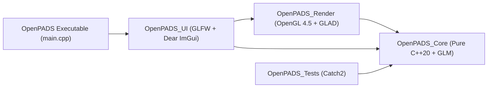
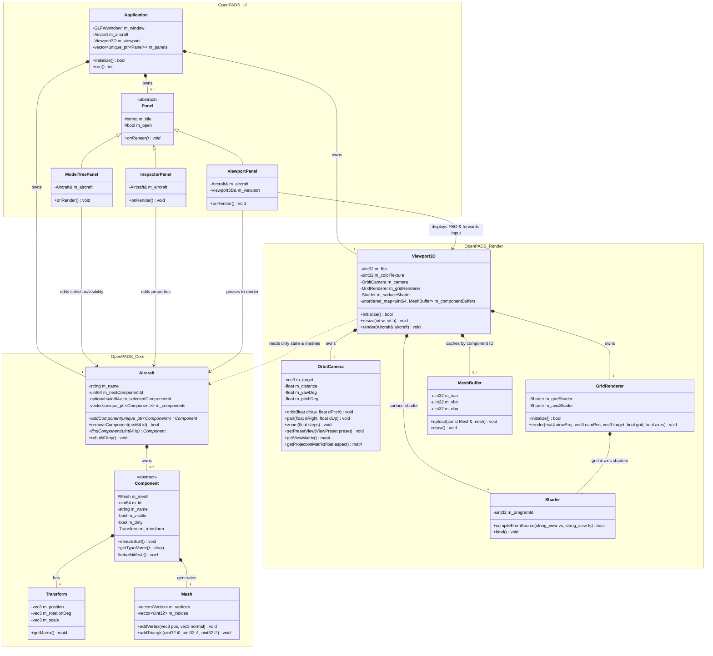
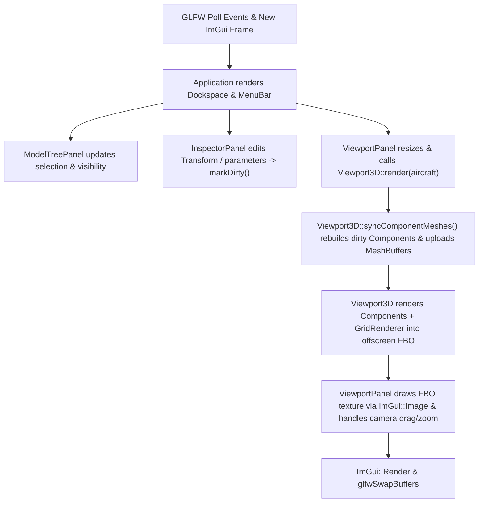

# OpenPADS Architecture & Class Hierarchy

OpenPADS separates **parametric aircraft data**, **3D rendering**, and **editor UI** into three static libraries linked by the `OpenPADS` executable. This keeps the geometry and engineering kernel (`OpenPADS_Core`) completely free of OpenGL/windowing dependencies so future aerodynamic solvers, optimizers, and flight-simulation modules can link it directly.

---

## Module Dependency Flow

---

## Class Hierarchy & Ownership

---

## Per-Frame Update Flow

---

## File Map

| Module | File | Responsibility |
| :--- | :--- | :--- |
| **Core** | `src/core/Transform.hpp/.cpp` | Aerospace Z-up position, Euler rotation, scale, and model matrix |
| **Core** | `src/core/Mesh.hpp/.cpp` | Indexed triangle mesh (`Vertex` positions + normals) |
| **Core** | `src/core/Component.hpp/.cpp` | Abstract base class for aircraft components (`Wing`, `Fuselage`, etc.) |
| **Core** | `src/core/Aircraft.hpp/.cpp` | Root container owning components, IDs, selection, and dirty rebuilds |
| **Render** | `src/render/OrbitCamera.hpp/.cpp` | Spherical orbit/pan/zoom camera and CAD view presets |
| **Render** | `src/render/Shader.hpp/.cpp` | RAII OpenGL shader compiler and uniform helpers |
| **Render** | `src/render/MeshBuffer.hpp/.cpp` | GPU `VAO`/`VBO`/`EBO` buffer lifecycle for `Mesh` |
| **Render** | `src/render/GridRenderer.hpp/.cpp` | Procedural anti-aliased `Z = 0` grid and origin RGB triad |
| **Render** | `src/render/Viewport3D.hpp/.cpp` | Offscreen FBO renderer, lighting shader, and mesh cache |
| **UI** | `src/ui/Panel.hpp/.cpp` | Abstract base class for dockable UI panels |
| **UI** | `src/ui/ModelTreePanel.hpp/.cpp` | Hierarchy outliner for `Aircraft` and `Component` items |
| **UI** | `src/ui/InspectorPanel.hpp/.cpp` | Property editor for selected aircraft/component transforms & metrics |
| **UI** | `src/ui/ViewportPanel.hpp/.cpp` | Hosts `Viewport3D` image, view toolbar, and mouse camera controls |
| **UI** | `src/ui/Application.hpp/.cpp` | Window, OpenGL context, Dear ImGui dockspace, theme, and main loop |
| **App** | `src/main.cpp` | Program entry point |
| **Tests** | `tests/CoreTests.cpp` | Catch2 unit tests for `Transform`, `Component`, and `Aircraft` |
